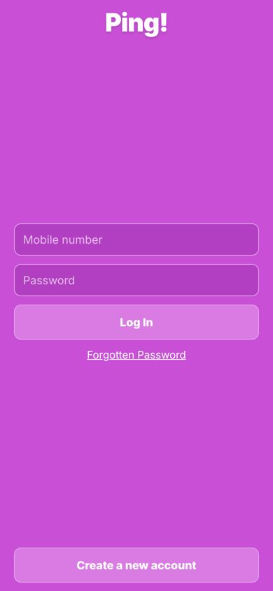
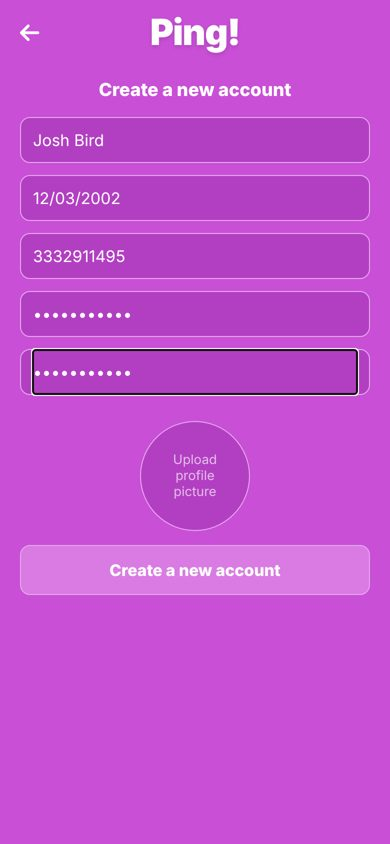
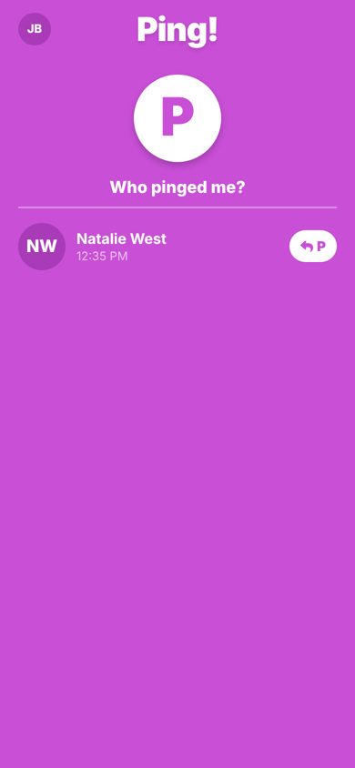
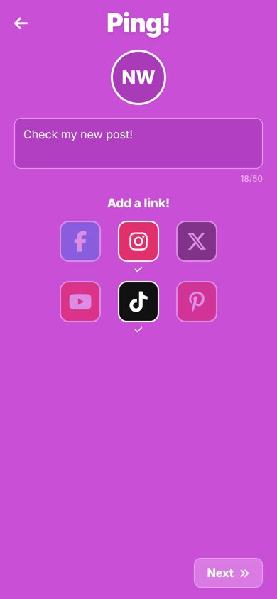
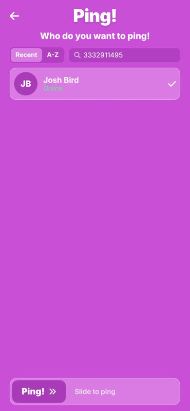
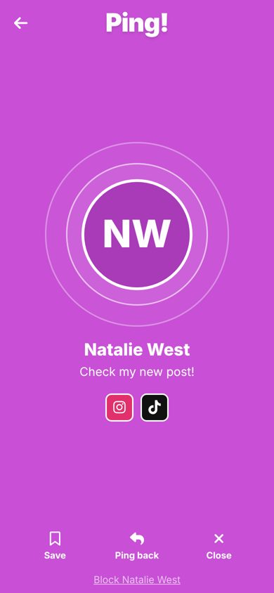
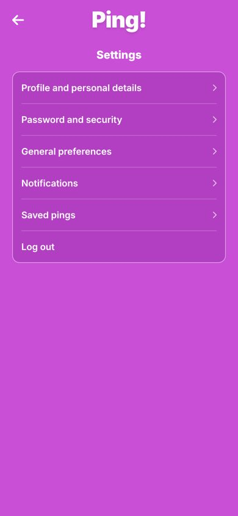
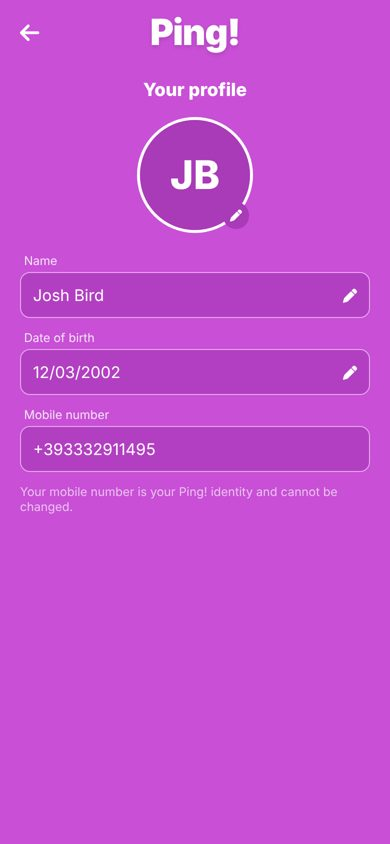
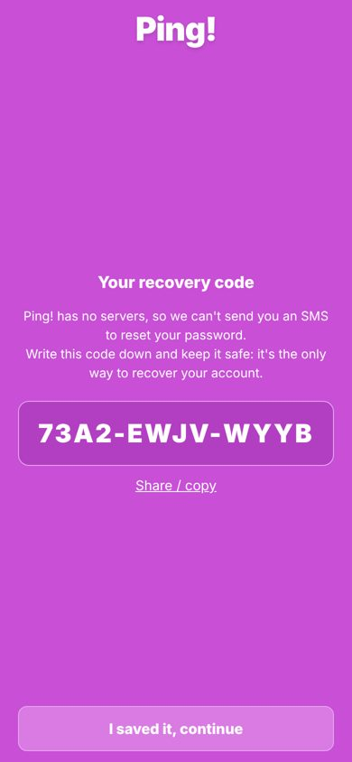

# Ping! — app mobile React Native + Expo + GUN

Implementazione dell'MVP descritto nella presentazione `ping_v3.pptx`:
un'app che manda un **"ping"**, cioè una notifica con nome e foto del mittente, un messaggio breve (max 50 caratteri) e fino a 6 link ai social (Facebook, Instagram, X, YouTube, TikTok, Pinterest).
Il ping è **transitorio**: quando lo vedi, sparisce.

**Senza server applicativo, senza database, senza API**: i dati viaggiano su **[GUN](https://gun.eco)**, un database a grafo peer-to-peer, e sono cifrati end-to-end con **SEA**, il modulo crittografico di GUN.

| | | | | |
|---|---|---|---|---|
|  |  |  |  |  |
|  |  |  |  |  |

📐 **Diagrammi** (architettura, casi d'uso, navigazione, sequenze, ciclo di vita, struttura dati): [`docs/DIAGRAMMI.md`](docs/DIAGRAMMI.md)

---

## 1. Avvio rapido in VS Code

### Prerequisiti
- **Node.js 20+** (consigliato 22 LTS)
- **VS Code**, con queste estensioni consigliate:
  - *Expo Tools* (`expo.vscode-expo-tools`): autocompletamento di `app.json`
  - *Markdown Preview Mermaid Support* (`bierner.markdown-mermaid`): mostra i diagrammi
  - *ESLint* e *Prettier* (facoltative)
- Sul telefono: l'app **Expo Go** (App Store / Play Store), *oppure* un emulatore Android o un simulatore iOS

### Passi
Apri la cartella `ping-app` in VS Code (**File → Open Folder**), poi apri il terminale integrato (`` Ctrl+` ``).

**1. Installa le dipendenze**
```bash
npm install
```

**2. Avvia il relay GUN** (in un primo terminale)
```bash
npm run relay
```
Vedrai `Ping! relay listening on http://0.0.0.0:8765/gun`.

**3. Indica all'app dove si trova il relay.** Trova l'IP del tuo PC nella rete Wi-Fi (`ipconfig` su Windows, `ipconfig getifaddr en0` su Mac), poi crea il file `.env` partendo dall'esempio:
```bash
cp .env.example .env
```
e scrivi il tuo IP:
```
EXPO_PUBLIC_GUN_PEERS=http://192.168.1.23:8765/gun
```

**4. Avvia l'app** (in un secondo terminale)
```bash
npx expo start
```
Inquadra il QR code con Expo Go: il telefono deve essere sulla **stessa rete Wi-Fi** del PC. Premi `a` per l'emulatore Android, `i` per il simulatore iOS, `w` per il browser.

> 💡 **Provare con due utenti senza due telefoni:** premi `w` e apri due finestre del browser, di cui una in incognito. Registra due account con numeri diversi. Nella schermata *"Who do you want to ping!"* scrivi nella barra di ricerca il numero completo dell'altro utente: comparirà anche se non è nella tua rubrica.

### Comandi utili
```bash
npm run typecheck
```
```bash
npx expo start --clear
```

---

## 2. Come funziona: "niente server" con GUN

### Il problema
Un'app di messaggistica di solito ha un **backend**: un server con API REST e un database dove salvare utenti e messaggi. Tu non vuoi né server né database.

### La soluzione: GUN
GUN è un **database a grafo distribuito**: ogni dispositivo ne ha una copia (parziale) e le modifiche si propagano in tempo reale agli altri peer, via WebSocket. Si usa come un oggetto JavaScript:

```js
gun.get('ping-app-v1').get('inbox').get(pubDiJosh).get(idPing).put({ from, box, ts }); // scrivere
gun.get('ping-app-v1').get('inbox').get(mioPub).map().on((ping, id) => { … });      // ascoltare
```

Non ci sono tabelle, query SQL o endpoint: **il grafo è il database**, e la logica sta tutta nell'app.

### Perché serve comunque un "relay"
Due telefoni su reti diverse (4G, Wi-Fi di casa…) **non possono collegarsi direttamente**: nessuno dei due è raggiungibile da Internet. Serve almeno un nodo sempre acceso che faccia da **ponte** e tenga una **cache** dei dati, così un ping arriva anche se il destinatario era offline.

Questo nodo è il **relay** (`relay/server.js`, 20 righe). È importante capire cosa **non** è:

| Server tradizionale | Relay GUN |
|---|---|
| Codice tuo con la logica dell'app | Programma GUN standard, nessuna logica di Ping! |
| API REST (`/login`, `/sendPing`…) | Nessuna API: sincronizza solo il grafo |
| Database con tabelle | Cache del grafo su file |
| Vede i messaggi in chiaro | Vede **solo dati cifrati** |
| Se cade, l'app non funziona | Se ne metti 2-3, l'app usa quello disponibile |

Per la produzione puoi pubblicarlo gratis o quasi su Render, Fly.io, Railway, oppure su un Raspberry Pi. In `EXPO_PUBLIC_GUN_PEERS` puoi elencare **più relay** separati da virgola: i dati vengono replicati su tutti.

> ℹ️ **Perché non `gun-react`?** Il pacchetto [`gun-react`](https://www.npmjs.com/package/gun-react) carica GUN aggiungendo tag `<script>` al `document` del browser e dipende da `jsdom` e `react-router-dom`: **non può funzionare in React Native**, dove non esiste il DOM (inoltre non viene aggiornato da anni). Per questo l'app usa direttamente la libreria **`gun`**, cioè la stessa che `gun-react` racchiude, più due piccoli hook React scritti apposta in `src/hooks/useGun.ts` (`useGunNode`, `useProfile`). Fanno la stessa cosa di gun-react: si abbonano a un nodo del grafo e aggiornano lo stato React in tempo reale.

### Identità e login senza server (GUN SEA)
- Alla **registrazione** SEA genera una coppia di chiavi crittografiche. La chiave privata viene **cifrata con la password** e pubblicata nel grafo sotto l'alias `ping-app-v1:+39…`.
- Il **login** scarica quel blocco cifrato e prova a decifrarlo con la password: se ci riesce, possiedi le chiavi e quindi sei tu. La password non lascia mai il telefono.
- Ogni utente ha uno spazio `~<chiave pubblica>` dove **solo lui può scrivere**: ogni scrittura è firmata.

### Cifratura end-to-end dei ping
Il mittente calcola un **segreto condiviso** (ECDH) con la propria chiave privata e la chiave pubblica del destinatario, e cifra `{nome, testo, link}`. Solo il destinatario può ricalcolare lo stesso segreto e decifrare. Se la decifratura fallisce, il ping è falso e viene scartato: questo autentica anche il mittente.

### Polyfill crittografici (dettaglio tecnico)
SEA usa la WebCrypto del browser, che React Native non ha. `src/polyfills.ts` la fornisce così:
- `crypto.getRandomValues` → **expo-crypto**
- `crypto.subtle` → **react-native-webview-crypto**, che esegue la crittografia in una WebView invisibile (`<PolyfillCrypto />` in `_layout.tsx`)

Per questo `import '../polyfills'` è **la prima riga** di `src/app/_layout.tsx`.

---

## 3. Struttura del progetto

```
ping-app/
├─ src/
│  ├─ polyfills.ts            WebCrypto per GUN SEA (primo import!)
│  ├─ app/                    Schermate (Expo Router: 1 file = 1 schermata)
│  │  ├─ _layout.tsx          Provider, navigazione, schermate protette
│  │  ├─ index.tsx            1.  Opening screen
│  │  ├─ login.tsx            2.1 Log-in
│  │  ├─ signup.tsx           3.1 Create a new account
│  │  ├─ recovery-code.tsx        Codice di recupero (sostituisce l'SMS)
│  │  ├─ reset-request.tsx    4.1 Password reset – codice
│  │  ├─ reset-password.tsx   4.2 Password reset – nuova password
│  │  ├─ home.tsx             5.1 Main screen "Who pinged me?"
│  │  ├─ compose.tsx          6.1 User card (testo + link social)
│  │  ├─ contacts.tsx         6.2 Lista contatti + slide to send
│  │  ├─ ping/[id].tsx        7.1 Ping ricevuto (rimbalzo + suono)
│  │  ├─ profile.tsx          8.1 Profilo
│  │  ├─ settings.tsx         9.1 Settings
│  │  ├─ preferences.tsx          Preferenze, notifiche, utenti bloccati
│  │  ├─ saved.tsx                Ping salvati
│  │  └─ change-password.tsx      Cambio password
│  ├─ lib/                    Logica (nessuna UI)
│  │  ├─ config.ts            ⚙️ Parametri: relay, limiti, colori
│  │  ├─ gun.ts               Istanza GUN + SEA, helper once/put
│  │  ├─ auth.ts              Registrazione, login, recupero password
│  │  ├─ pings.ts             Invio/ricezione ping cifrati
│  │  ├─ profile.ts           Profilo, stato Online
│  │  ├─ contacts.ts          Rubrica → chi ha Ping!
│  │  ├─ notifications.ts     Notifiche locali + push Expo (facoltative)
│  │  ├─ links.ts             Social ammessi e validazione link
│  │  ├─ phone.ts             Normalizzazione numeri (+39…)
│  │  ├─ storage.ts           Dati solo-locali (SecureStore/AsyncStorage)
│  │  └─ avatar.ts            Scelta e compressione foto profilo
│  ├─ context/                Stato globale React (sessione, ping, impostazioni)
│  ├─ hooks/useGun.ts         Hook React per GUN (al posto di gun-react)
│  └─ components/             UI riutilizzabile (card ping, slide, swipe…)
├─ relay/server.js            Relay GUN (npm run relay)
├─ assets/ping.wav            Suono "ping"
└─ docs/DIAGRAMMI.md          Diagrammi
```

---

## 4. Dalla presentazione al codice: scelte e differenze

| Presentazione | Implementazione | Perché |
|---|---|---|
| Login con numero e password, verificati dal server | Login con **GUN SEA**: la password decifra le chiavi | Nessun server |
| SMS di conferma del numero e codice di reset via SMS | **Codice di recupero** mostrato alla registrazione | Mandare SMS richiede un server e un provider a pagamento. Vedi §5 |
| "Database to mobile / Mobile to database" | Lettura/scrittura sul **grafo GUN** | Non c'è un database |
| Lista ping tenuta "per un breve periodo [TBD]" | 24 ore (`PING_TTL_HOURS` in `config.ts`) | Configurabile |
| Messaggio di 30-50 caratteri | 50 (`MAX_MESSAGE_LENGTH`) | Configurabile |
| Versione base: un destinatario alla volta | `MAX_RECIPIENTS = 1` | Alzalo per la versione premium |
| Link vietati nel testo | Blocco automatico + validazione del dominio per ogni social | Slide 6.1 |
| Invito WhatsApp a chi non ha l'app | Pulsante **Invite** (link `wa.me`) nella lista contatti | Slide 2 |
| Possibilità di salvare i ping | Pulsante **Save** (solo sul telefono) + schermata *Saved pings* | Slide 3 |
| Notifiche sulla lock screen | Notifiche locali + push Expo facoltative | Vedi §5 |

---

## 5. Limiti onesti di un'architettura "senza server"

1. **Serve almeno un relay acceso.** Senza relay i telefoni non si trovano. Il relay non è un backend, ma è comunque un processo da tenere in esecuzione.
2. **Notifiche ad app chiusa.** Quando l'app è chiusa, il sistema operativo la sospende e GUN non riceve nulla. Svegliare il telefono è possibile **solo** con il servizio push di Apple o Google. L'app usa il servizio gratuito di **Expo Push**, chiamato direttamente dal telefono del mittente. Per attivarlo:
   - crea un progetto con `npx eas-cli@latest init`, che compila `extra.eas.projectId` in `app.json`;
   - usa una **development build**: `npx expo run:android`, oppure `npx eas-cli@latest build --profile development`. Su Android le push non funzionano in Expo Go.
   - Se non vuoi nessun servizio esterno, metti `ENABLE_EXPO_PUSH = false`: avrai solo le notifiche locali, ad app aperta o appena chiusa.
3. **Niente SMS.** Il numero di telefono non viene verificato. Chi perde **sia** la password **sia** il codice di recupero perde l'account: non esiste un amministratore che possa ripristinarlo.
4. **Inbox pubblica.** Chiunque può *scrivere* nella tua inbox. I ping falsi vengono scartati perché non si decifrano, e puoi bloccare gli utenti; ma un malintenzionato potrebbe cancellare i ping altrui prima che vengano letti. Per un MVP è accettabile; più avanti si può passare a una "outbox" firmata da ciascun mittente.
5. **Profili pubblici.** Nome, numero e foto sono leggibili da chiunque conosca il numero (serve per mostrare la card del ping). La data di nascita è cifrata.
6. **Foto profilo** salvate nel grafo come JPEG compresso (256 px, circa 20 KB). Va bene per un MVP; per immagini grandi servirebbe uno storage di file.

---

## 6. Personalizzazione veloce (`src/lib/config.ts`)

| Costante | Default | Significato |
|---|---|---|
| `GUN_PEERS` / `EXPO_PUBLIC_GUN_PEERS` | IP locale | Indirizzi dei relay |
| `DEFAULT_COUNTRY_CODE` | `39` | Prefisso per numeri senza `+` |
| `MAX_MESSAGE_LENGTH` | `50` | Caratteri del messaggio |
| `PING_TTL_HOURS` | `24` | Durata dei ping non letti |
| `MAX_RECIPIENTS` | `1` | Destinatari per ping (premium: di più) |
| `ENABLE_EXPO_PUSH` | `true` | Push ad app chiusa tramite Expo |
| `INVITE_URL` | segnaposto | Link allo store per l'invito WhatsApp |
| `COLORS` | viola Ping! | Palette |

---

## 7. Pubblicare sugli store
```bash
npx eas-cli@latest build --platform all
```
```bash
npx eas-cli@latest submit
```
Prima cambia `ios.bundleIdentifier` e `android.package` in `app.json` (ora `com.example.pingapp`) e sostituisci le icone in `assets/`.
