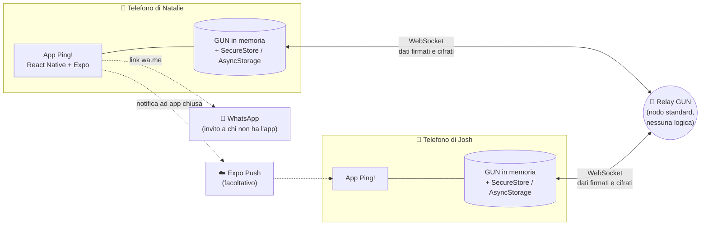
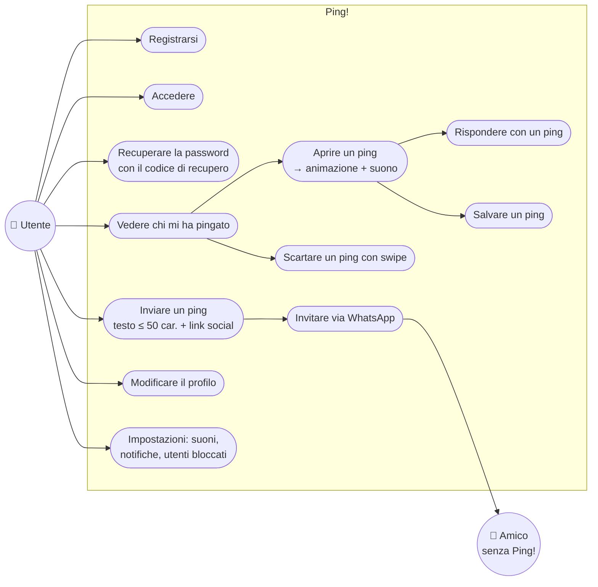
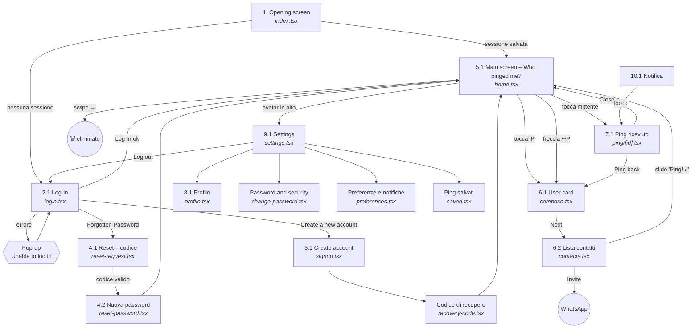
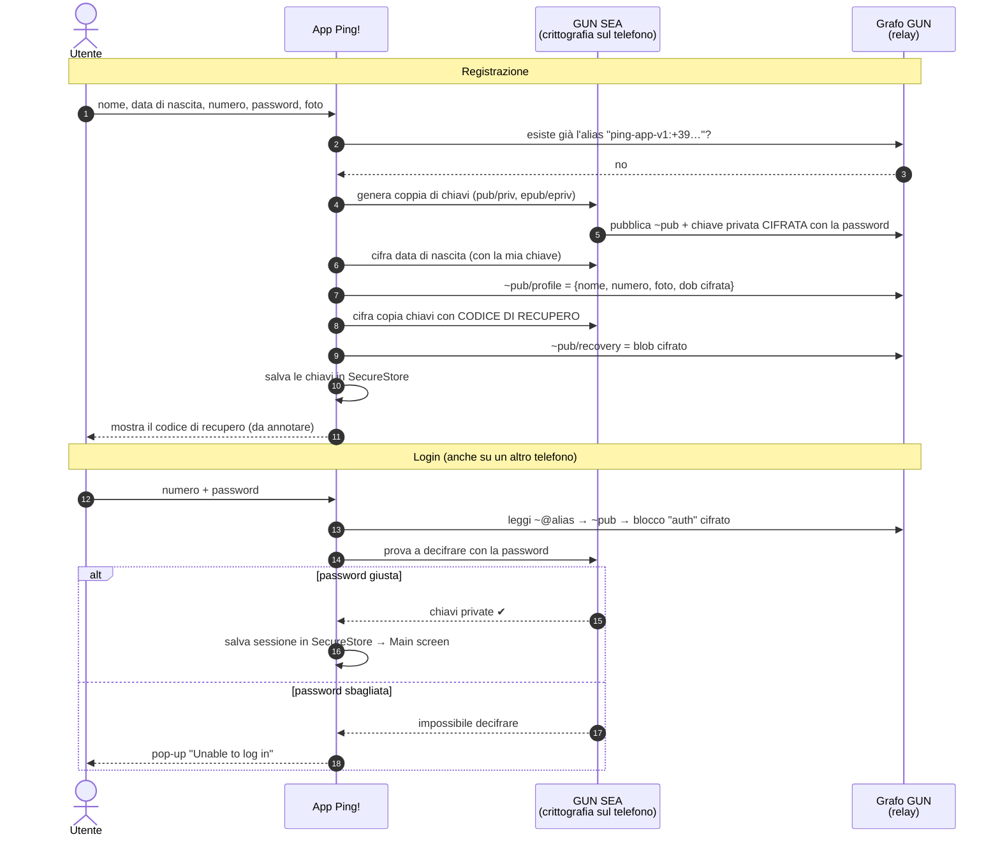
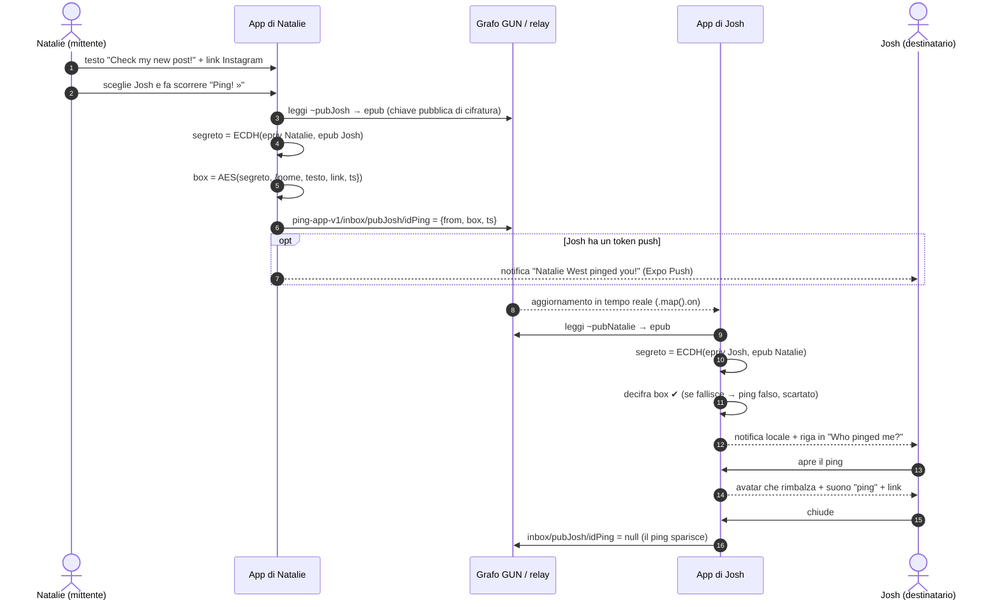
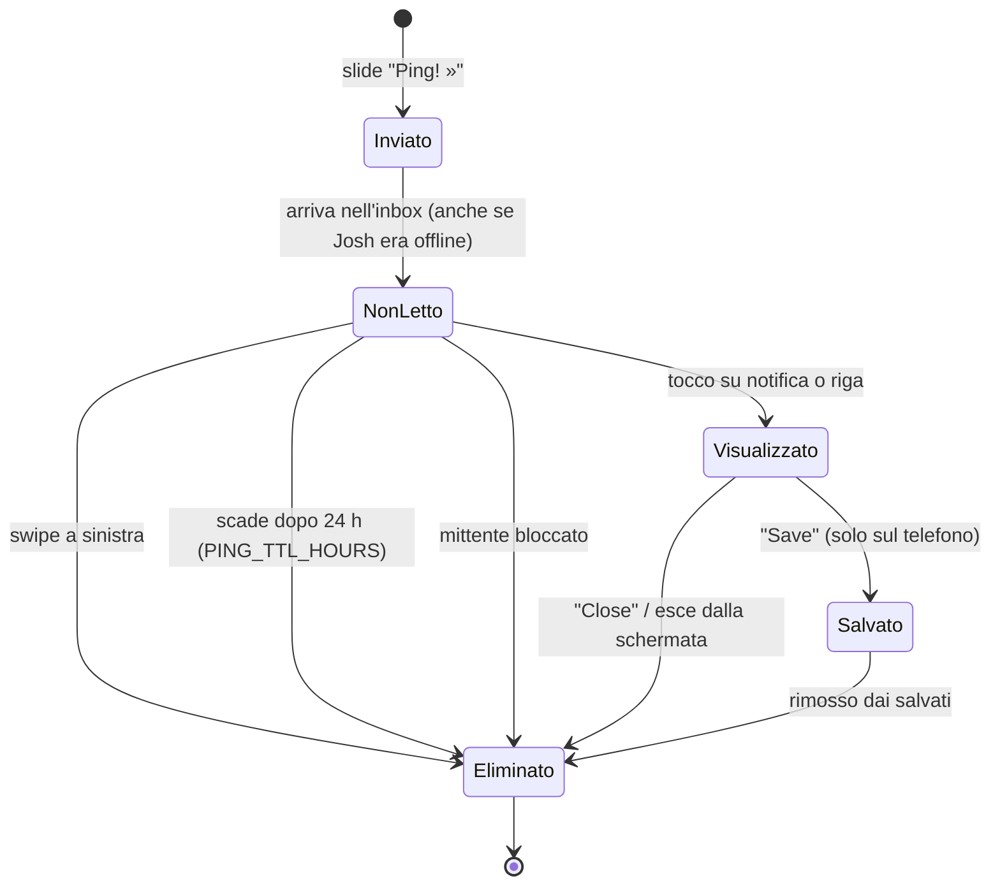
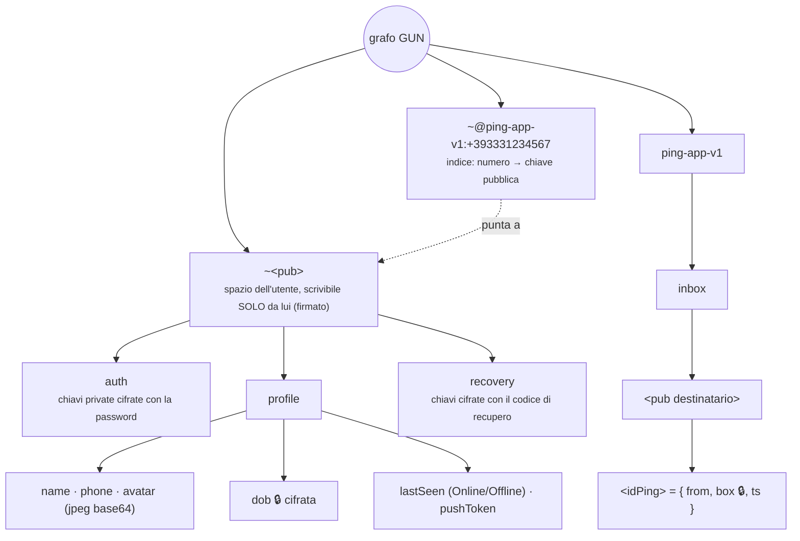

# Ping! — Diagrammi

Tutti i diagrammi sono in [Mermaid](https://mermaid.js.org/): si vedono già renderizzati su GitHub e in VS Code con l'estensione **Markdown Preview Mermaid Support** (`bierner.markdown-mermaid`), aprendo l'anteprima con `Ctrl+Shift+V`.

---

## 1. Architettura: niente server applicativo, niente database

- Il **grafo GUN** è il "database": un grande oggetto JSON replicato fra telefoni e relay.
- Il **relay** è solo un ponte/cache: è il programma GUN standard (`relay/server.js`), non ha API né tabelle, e vede **solo testo cifrato**.
- Nessun backend scritto da te: tutta la logica (login, cifratura, invio) gira **sul telefono**.

---

## 2. Casi d'uso

---

## 3. Navigazione fra le schermate (riferimenti alle slide)

---

## 4. Registrazione e login (GUN SEA)

---

## 5. Invio e ricezione di un ping (cifrato end-to-end)

---

## 6. Ciclo di vita di un ping

---

## 7. Struttura dei dati nel grafo GUN

Dati che restano **solo sul telefono** (slide 9.2 "NA if all settings are saved locally"):

| Dove | Cosa |
|---|---|
| SecureStore (cifrato dal sistema) | la coppia di chiavi = sessione di login |
| AsyncStorage | impostazioni (suoni, notifiche, bloccati), ping salvati, contatti recenti, cache rubrica |
